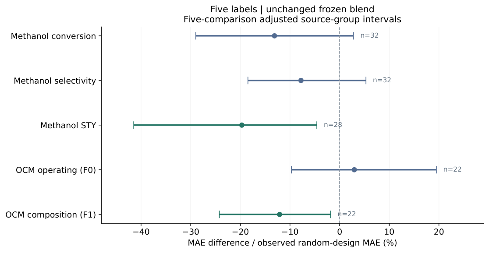

# Catalysis source adaptation

[中文说明](README.zh-CN.md) · [Reproduction guide](docs/REPRODUCING.md) · [Licences](THIRD_PARTY_NOTICES.md)

**How well do literature-trained catalyst models predict an unseen publication,
and how much can a few measured outcomes from that publication help?**

This repository releases the current manuscript, original research code,
frozen inputs, fitted backbones, row-level predictions, support/query ledgers,
and result audits. It studies publication-disjoint evaluation, local calibration,
the information supplied by a few labels, and matched-budget measurement selection.
Classical ridge regression and V-optimal design are not claimed as new algorithms.

## Start here

1. Read `paper/pdfs/论文中文版_原稿逻辑整合修订.pdf` or the English main text in the same folder.
2. Inspect `results/primary_selection.csv`, linked to the current manuscript table.
3. Run the integrity check (Python 3.12, standard library only):

```bash
python scripts/verify_release.py
```

4. Independently recompute the latest extension's errors from measured outcomes
   and stored predictions, without retraining:

```bash
python -m pip install -r requirements-minimal.txt
python scripts/audit_predictions.py --output work/prediction_audit.json
```

5. For fresh scientific predictions in a separate working directory:

```bash
python -m pip install -r requirements.txt
python scripts/reproduce.py smoke --destination work/smoke --workers 1
```

The smoke run generates one historical fold from archived inputs/backbones.
It is not a retraining of every backbone or a repetition of all paper analyses.
See `docs/REPRODUCING.md` for the complete extension and older analysis entry points.
CPU execution is supported; the archived environment used about four workers.

## Main matched-budget comparison

Five labels and the same blend-predictor configuration:

| Task | Random MAE | Query-V MAE | Reduction |
| --- | ---: | ---: | ---: |
| Methanol STY | 62.608 | 50.274 | 19.7% |
| OCM, conditions + composition | 3.081 | 2.708 | 12.1% |

STY uses mg h^-1 gcat^-1; OCM uses percentage points. Both comparisons pass
the predeclared five-panel multiplicity adjustment. The CSV also includes
all other primary panels and their adjusted intervals; effects are task-dependent.



## Repository map

| Path | Contents |
| --- | --- |
| `paper/pdfs/` | Current integrated main texts and complete supplementary PDF |
| `paper/source/` | Editable LaTeX, frozen tables, English/Chinese figures, fonts |
| `research/step11/` | Original complete calculation archive, including predecessor analyses |
| `results/` | Current primary table and editorial evidence |
| `scripts/` | Public verification, independent error recomputation, fresh-run launchers |
| `docs/` | Reproduction, provenance, licences, publishing instructions, explanation |

The numbered historical directories are preserved because their relative paths
are part of the original runnable experiment chain. Current reading PDFs live
under `paper/pdfs/`; older manuscripts inside `research/` are historical snapshots.
Use the current paper's correction/claim mapping instead of mixing old and new
baseline values across protocols.

## Evidence and scope

- The original source archive passed all 3,695 file checks before public packaging.
- Row-level measured outcomes and predictions for the final extension can be
  checked using `scripts/audit_predictions.py`.
- Archived extension totals: 10,948,000 scalar predictions; historical records
  also document 2,737,000 independent fixed-RBF reconstruction checks.
- No new wet experiments were performed. Twenty catalyst-ID partitions share
  one opened experimental family and are not twenty independent sources.
- Source means publication identity, not verified laboratory identity.
- The latest Chinese wording is an editorial revision; the English text and
  historical numerical files preserve their original protocol-specific values.

## License and citation

Original project code: [MIT](LICENSE). Third-party data, fonts, articles and
manuscripts have separate conditions: read [THIRD_PARTY_NOTICES.md](THIRD_PARTY_NOTICES.md).
Two optional raw source assets are fetched separately; frozen scientific inputs
and predictions required for the documented core checks are included.
Use the repository's `CITATION.cff` and cite the source datasets as appropriate.
This is a software/data-analysis release, not a claim of journal acceptance.

To upload the unpacked repository with Git or GitHub Desktop, read
[GitHub publishing instructions](docs/GITHUB_UPLOAD_CN.md).
